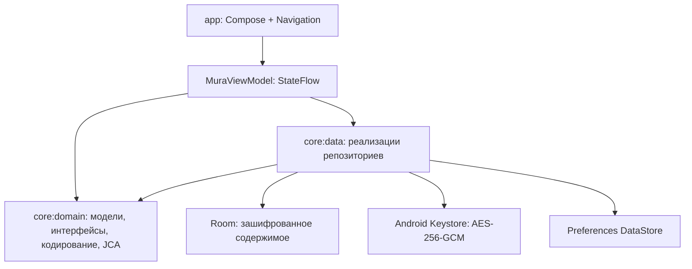

# Архитектура

`core:domain` — независимый от Android Kotlin/JVM-модуль. Содержит DecimalCodec, PasswordCipher, модели и контракты репозиториев. `SecureTransport` — только контракт будущего транспорта, рабочая сетевая реализация намеренно отсутствует.

`core:data` — Room DAO, экспортированная схема v1, репозитории и Keystore. Текст, результаты и имена контактов шифруются до Room. Связь с диалогом, направление сообщения и назначение поля входят в GCM AAD. Записи чатов удаляются каскадно. Записи шифратора и сообщения используют независимые таблицы и общее избранное на экране истории.

`app` — MVVM, Compose Material 3 и Navigation Compose. `MuraViewModel` координирует чистые преобразования и репозитории. Долгая криптография идёт в `Dispatchers.Default`, база и локальное шифрование — в `Dispatchers.IO`. Конструкторная передача зависимостей через `AppContainer`; отдельный DI-фреймворк для такого MVP не требуется.

Реактивные потоки Room → Repository → StateFlow → `collectAsStateWithLifecycle`. Мутации сериализованы Mutex; шифрование и смена ключа не пересекаются с чтением. После полного удаления старые снимки Flow отфильтровываются по монотонным Room id, затем удаляется прежний ключ. Ошибки хранилища видны пользователю и не подменяются успешным результатом.

Навигация: Шифратор / Чаты / История / Настройки + экран диалога. На ширине от 700 dp используется NavigationRail. Локализация централизована в типизированном каталоге `Strings.kt` со всеми тремя переводами. Значения пользовательских настроек хранятся в DataStore, текстовые черновики — только в памяти.

Биометрическая блокировка устанавливается при уходе Activity в фон. Сначала загружаются настройки, затем решается, показывать ли защищённый интерфейс. Активация требует BiometricPrompt с BIOMETRIC_STRONG. `FLAG_SECURE` предотвращает снимки экрана и содержимое в обзоре недавних приложений.

Автоочистка идёт на старте и раз в минуту в жизненном цикле ViewModel. Избранные записи исключены. Если понадобится строгий фоновый график, добавить WorkManager с отдельно согласованной политикой сохранения данных.

В версии 1.1 добавлена миграция Room 1 → 2, сохраняющая прежнюю историю. `NetworkRepository` координирует зашифрованную идентичность, контакты, очередь, дедупликацию и проверяемые квитанции. `ChatCrypto` и `RelayClient` в domain совместимы с iOS. Сеть работает на Dispatchers.IO при открытом и разблокированном приложении. Подробности — [NETWORK.md](NETWORK.md).

Для развития: пагинация и индексы поиска, вынос экранов в feature-модули, локальное извещение о загрузке больших архивов, независимый security review.
